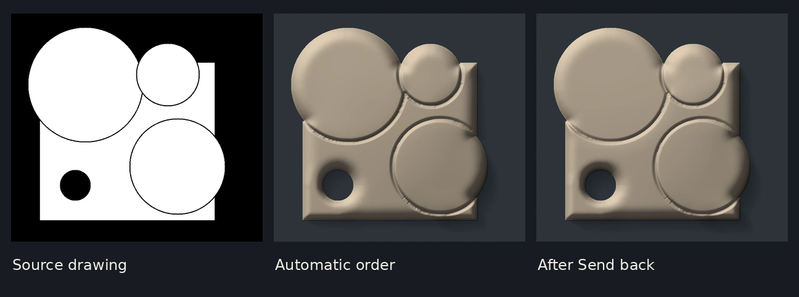

# MONOLITH Relief Studio

MONOLITH converts raster line drawings into bas-relief heightmaps. A Python service processes the drawing and stores projects locally. A browser-based editor displays the relief and controls its physical dimensions, layer order, brush edits, and exports.



The upper-left circle starts in front of the rectangle. Selecting it in **Layers** and choosing **Send back** places it behind the rectangle. Both reliefs use the same view and lighting.

## Run from source on Linux

Install Python 3.10 with venv support (on Debian or Ubuntu, install the matching python3-venv package), Node.js 20 or newer, npm, and Bash. From the repository root run:

```sh
./start.sh
```

The first run downloads dependencies. Open [the studio](http://127.0.0.1:5173) in a WebGL-capable browser. The [API reference](http://127.0.0.1:8000/docs) is available while the service is running. Press Ctrl+C in the terminal to stop the studio. Project files and the SQLite database are stored under `data/`. Set `MONOLITH_DATA_DIR` before launch to use a different directory.

## Generate a relief

1. Load the geometric example or upload a line drawing. Select the drawing polarity if automatic detection picks the wrong background.
2. Choose a resolution and generate the relief. Sculpt builds volumes from enclosed regions. Classic uses a weighted combination of height fields.
3. Open the 3D editor. Set the width, relief depth, and backing thickness in millimetres. In Sculpt mode, use Layers to change which region sits in front. Use the cross-section view to inspect heights.
4. Export a heightmap (PNG, TIFF, or OpenEXR), a mesh (STL or OBJ), or a silhouette outline (SVG or DXF). Adaptive mesh tolerance is measured vertically at heightmap samples. A zero-thickness backing selects the grid mesh for a cut-out.

Draft angle controls the procedural relief profile. Brush edits and frames can introduce steeper surfaces. The editor does not simulate a cutter or toolpath.

## Development

The image pipeline and exporters are in `backend/pipeline/`. The FastAPI routes are in `backend/main.py`. The React and Three.js editor is in `frontend/src/`.

After the first launch, run the following from the repository root:

```sh
(cd frontend && npm test && npm run build)
.venv/bin/python -m pytest -q
```

The backend packaging test uses the built frontend. Set `MONOLITH_CHECK_TIMINGS=1` to enable machine-dependent latency assertions. To build a Windows bundle, dispatch the Windows packaging workflow. Extract its ZIP and run `Start MONOLITH.bat`.

## Algorithm references

- Guided filtering for depth ordering follows He, Sun, and Tang, *Guided Image Filtering*, ECCV 2010. [Paper and implementation notes](https://people.csail.mit.edu/kaiming/eccv10/index.html)
- Adaptive surface triangulation uses a right-triangulated irregular network. [Mapbox Martini](https://github.com/mapbox/martini)

## License

The MONOLITH source and bundled geometric example are licensed under the GNU General Public License, version 3 only (`GPL-3.0-only`). Dependencies retain their respective licenses. [License text](LICENSE)
